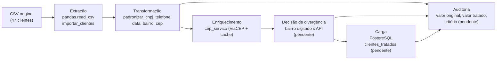

# Documentação técnica (rascunho)

Projeto Integrador · Desafio Técnico 1 · ETL, limpeza e enriquecimento de dados da *Distribuidora Vetor*.

> **Status deste documento: rascunho.** Descreve o que já existe no repositório. As partes ainda em desenvolvimento por outros cards (decisão de divergência, auditoria, carga final, mocks e pipeline único) aparecem marcadas como **pendente** e serão completadas quando ficarem prontas.

Documentos relacionados: [README](../README.md) · [Regras de negócio](REGRAS_DE_NEGOCIO.md) · [Estrutura dos documentos](ESTRUTURA_DOCUMENTOS.md)

---

## 1. Visão geral

A Distribuidora Vetor é uma atacadista B2B fictícia. Sua base de clientes foi preenchida por pessoas diferentes, em momentos diferentes, sem padronização. Isso atrapalha relatórios por região: o mesmo bairro aparece como várias linhas diferentes ("Águas Claras", "Aguas claras", "AGUAS CLARAS", "Norte (Águas Claras)").

**Objetivo:** construir um pipeline ETL em Python que receba o CSV de clientes, identifique as inconsistências, produza uma base limpa e enriquecida, persista em PostgreSQL e registre cada decisão de tratamento.

**Tecnologias:** Python, pandas, Django, SQLAlchemy, PostgreSQL (psycopg2), requests (API ViaCEP), pytest.

---

## 2. Entregáveis do desafio e situação

| Entregável pedido no desafio | Onde está | Situação |
|---|---|---|
| Pipeline de ETL (extração, transformação e carga) | `padronizar_Clientes.py`, `cep_servico.py`, `importar_clientes.py`, `main.py` | Parcial: `main.py` pendente |
| Base final tratada em banco SQL | tabela `clientes_tratados` (`loader.py`) | Pendente |
| Tabela ou log de auditoria (original → tratado → critério) | tabela de auditoria e módulo de gravação | Pendente |
| Testes automatizados da normalização, com chamadas externas simuladas | `tests/` | Parcial: limpeza pronta, mocks da API pendentes |
| Documentação técnica com regras e limites conhecidos | este documento e `REGRAS_DE_NEGOCIO.md` | Rascunho |
| Relatório curto (1 a 2 páginas) de trade-offs | `docs/RELATORIO_TRADE_OFFS.md` | A fazer (roteiro em `ESTRUTURA_DOCUMENTOS.md`) |

---

## 3. Arquitetura do ETL



| Etapa | O que faz | Arquivos | Situação |
|---|---|---|---|
| **Extração** | Lê o CSV (separador `;`, tudo como texto para não perder zeros) ou o importa para o Django. | `padronizar_Clientes.py`, `importar_clientes.py` | Pronto |
| **Transformação** | Limpa CNPJ, telefone, data, bairro e CEP. | `padronizar_Clientes.py` | Pronto |
| **Enriquecimento** | Consulta o CEP no ViaCEP, com cache local, e compara com o cadastro. | `cep_servico.py`, `cache_cep.json` | Pronto |
| **Decisão** | Define qual dado prevalece quando bairro digitado e API divergem. | (código unificado) | Pendente |
| **Auditoria** | Registra o que mudou, de quê para quê e por quê. | (módulo de auditoria) | Pendente |
| **Carga** | Grava a base tratada no PostgreSQL e confere as quantidades. | `src/database/loader.py` | Pendente |
| **Orquestração** | Executa tudo em ordem com um comando. | `main.py` | Pendente |

---

## 4. Dados de entrada

Arquivo `clientes_distribuidora_vetor.csv`: **47 registros fictícios**, separador `;`.

| Coluna | Descrição |
|---|---|
| `id_cliente` | Identificador do cliente |
| `razao_social` | Nome do cliente |
| `cnpj` | CNPJ fictício, com formatos diferentes de propósito |
| `telefone` | Telefone, com formatos diferentes de propósito |
| `email` | E-mail fictício |
| `bairro_informado` | Bairro em texto livre (campo central do desafio) |
| `cep` | CEP informado: pode estar ausente, inválido ou não bater com o bairro |
| `cidade`, `uf` | Sempre Brasília e DF nesta amostra |
| `data_cadastro` | Data em vários formatos (ISO, brasileiro, texto em inglês) |
| `vendedor_responsavel` | Vendedor fictício |

**Resultado do diagnóstico e da limpeza na amostra** (executando `padronizar_Clientes.py`):

| Indicador | Resultado |
|---|---|
| Telefones não reconhecidos | 0 de 47 |
| Datas não reconhecidas | 0 de 47 |
| CNPJs que passam na conferência dos dígitos | 0 de 47 (CNPJs fictícios) |
| CEPs ausentes ou inválidos | 16 de 47 (13 vazios e 3 zerados) |
| Bairros distintos digitados | 25, mais 1 vazio |
| Bairros após a padronização | Águas Claras 22 · Taguatinga 10 · Vicente Pires 8 · Guará 6 · Não informado 1 |
| Grafias com subdivisão (Sul, Norte, I, II) | 9 de 26 valores únicos |

---

## 5. Regras de negócio

Todas as regras estão numeradas em [`REGRAS_DE_NEGOCIO.md`](REGRAS_DE_NEGOCIO.md). Resumo:

- **CNPJ:** remove pontuação, aceita letras (formato alfanumérico), aplica máscara e confere os dígitos verificadores, sem descartar registros inválidos.
- **Telefone:** mantém só dígitos, remove o `55`, formata celular (11 dígitos) e fixo (10).
- **Data:** aceita quatro formatos e devolve `AAAA-MM-DD`, lendo `DD/MM` e `DD-MM` como dia primeiro.
- **CEP:** 8 dígitos no formato `XXXXX-XXX`; `00000-000` é ausente.
- **Bairro:** versão sem acento e minúscula, dicionário de trechos, subdivisões descartadas, bairros desconhecidos só arrumados e vazio vira `Não informado`.
- **Valores nulos ou vazios:** nunca quebram o código.

---

## 6. Modelo de dados

### 6.1 Tabela `cliente_cliente` (modelo Django `Cliente`)

Criada pelo `python manage.py migrate` a partir do modelo em `cliente/models.py`.

| Campo | Tipo | Regras |
|---|---|---|
| `id_cliente` | inteiro automático | chave primária |
| `razao_social` | texto (255) | obrigatório |
| `email` | e-mail | opcional |
| `telefone` | texto (50) | opcional |
| `cnpj` | texto (20) | obrigatório e **único** |
| `bairro` | texto (100) | opcional |
| `cep` | texto (20) | opcional |
| `cidade` | texto (100) | opcional |
| `uf` | texto (2) | opcional |
| `data_cadastro` | data | opcional |
| `vendedor` | texto (100) | opcional |

**Histórico das migrations** (por que o modelo mudou):

| Migration | Mudança | Motivo provável |
|---|---|---|
| `0001_initial` | cria a tabela (CNPJ com 14 caracteres e único; CEP com 8; e-mail único) | primeira versão |
| `0002_alter_cliente_cnpj` | CNPJ passa a 20 caracteres | os CNPJs do CSV vêm com máscara (18 caracteres) |
| `0003_alter_cliente_cep` | CEP passa a 20 caracteres | os CEPs vêm com hífen ou em formato inválido |
| `0004_alter_cliente_email` | e-mail passa a opcional e deixa de ser único | nem todo cliente tem e-mail |

### 6.2 Tabelas definidas em `init.sql`

| Tabela | Finalidade | Colunas |
|---|---|---|
| `clientes_tratados` | base final tratada | `id`, `nome`, `cnpj_cpf` (único), `cidade`, `estado`, `data_cadastro`, `data_processamento` |
| `auditoria_etl` | registro das execuções do pipeline | `id`, `nome_pipeline`, `status_execucao`, `linhas_processadas`, `mensagem_erro`, `data_execucao` |

> **Pontos de atenção** (detalhados na seção 10): `clientes_tratados` ainda não tem colunas para bairro, CEP, telefone e e-mail, e `auditoria_etl` registra execuções, enquanto o card de auditoria pede um registro por campo alterado.

### 6.3 Conexão com o banco

- O Django usa as variáveis `DB_*` do `.env` (arquivo `core/settings.py`).
- O módulo `src/database/connection.py` usa as mesmas variáveis para criar uma conexão SQLAlchemy (`engine`) e uma fábrica de sessões (`SessionLocal`). A função `testar_conexao_banco()` valida a conexão, conta os clientes e testa escrita e leitura numa tabela temporária.

---

## 7. Serviço de CEP e cache

Arquivo `cep_servico.py`.

| Função | O que faz |
|---|---|
| `buscar_cep(cep)` | Limpa o CEP, valida os 8 dígitos, procura no cache, consulta o ViaCEP (limite de 5 segundos) e guarda respostas de sucesso no cache. Erros voltam como `{"erro": "..."}`. |
| `carregar_cache()` / `salvar_cache()` | Leem e gravam o arquivo `cache_cep.json`. Arquivo ausente ou corrompido resulta em cache vazio. |
| `normalizar_texto(texto)` | Deixa o texto sem acento, em minúsculas e sem espaços nas pontas, para comparar. |
| `validar_endereco(cliente)` | Compara bairro, cidade e UF do cliente com a resposta da API e devolve o status `VALIDADO`, `DIVERGENTE`, `INCOMPLETO` ou `ERRO`, sem alterar o cliente. |

Exemplo do formato do resultado de `validar_endereco` (valores ilustrativos):

```python
{
    "cliente": "Mercadinho Boa Vista",
    "cep": "71926-750",
    "status": "DIVERGENTE",
    "divergencias": {"bairro": {"cadastrado": "Sul (Águas Claras)", "viacep": "Águas Claras"}},
    "campos_nao_verificados": [],
}
```

O cache evita repetir consultas: na segunda vez que um CEP é pedido, a resposta vem do arquivo, sem internet. O script `teste_cep.py` serve para ver isso funcionando manualmente. Os testes automatizados com respostas simuladas (mocks) estão **pendentes**.

---

## 8. Testes

- **Ferramenta:** pytest. Configuração: `pytest.ini` e a pasta `tests/`.
- **Comando:** `python -m pytest -v`.
- **O que cobre hoje:** limpeza de CNPJ, telefone e data com vários exemplos de sujeira; normalização de bairros; tratamento de valores nulos ou vazios em todas as funções de limpeza.
- **Como são feitos:** os valores sujos são digitados dentro do próprio teste (copiados de exemplos reais do CSV). Não usam CSV, banco, Django nem internet.
- **Particularidade:** o script `padronizar_Clientes.py` lê o CSV e grava um arquivo no momento em que é importado. Por isso os testes carregam o módulo por um arquivo de apoio (`conftest.py`), numa pasta temporária, sem alterar o script.
- **Pendente:** testes da consulta de CEP simulando a API (`unittest.mock` ou `responses`), com cenários de sucesso e de falha, executáveis totalmente offline.

---

## 9. Configuração e segurança

- As credenciais ficam no arquivo **`.env`**, na raiz do projeto, **fora do Git** (`.gitignore`). O repositório traz apenas o modelo `.env.example`, sem valores secretos.
- O Django (`settings.py`) e o `connection.py` leem o mesmo `.env`.
- `DEBUG = True` e `ALLOWED_HOSTS = []` indicam configuração de **desenvolvimento**. Não devem ser usados em produção.
- Se uma senha antiga já foi enviada ao GitHub, ela continua no **histórico** do repositório mesmo depois de removida do arquivo. Troque a senha do PostgreSQL local por precaução.

---

## 10. Limites conhecidos

| # | Limite | Efeito |
|---|---|---|
| 1 | Subdivisões (Sul, Norte, I, II) são descartadas na padronização do bairro. | `Sul (Águas Claras)` e `Norte (Águas Claras)` viram o mesmo bairro. O detalhe só existe em `mapeamento_bairros.csv`. |
| 2 | O bairro é reconhecido por **trecho do texto**. | Qualquer texto que contenha "guara" vira *Guará* (por exemplo, `Guaraí`). |
| 3 | Bairros fora do dicionário só ganham maiúsculas. | `asa norte` vira `Asa Norte`, sem consulta externa. |
| 4 | Datas com barra ou hífen são lidas como dia primeiro. | Uma data como `04/08/2023` é sempre 4 de agosto. Não há como detectar a intenção. |
| 5 | O importador do Django e `padronizar_data` aceitam conjuntos de formatos diferentes. | `08-13-2022` é aceito pelo importador e vira `None` na limpeza. |
| 6 | A limpeza do CNPJ não confere os dígitos; isso é feito à parte. | Na amostra, 0 de 47 CNPJs passam (são fictícios). |
| 7 | O telefone só confere a quantidade de dígitos. | Um DDD inexistente passa. |
| 8 | `validar_endereco` compara o bairro **como cadastrado**. | `Sul (Águas Claras)` aparece como `DIVERGENTE` de `Águas Claras`, o que pode gerar divergências falsas. |
| 9 | O importador grava os dados como vieram. | `cliente_cliente` tem dados sujos; a base tratada é outra etapa. |
| 10 | Existem duas estruturas de tabela para clientes: `cliente_cliente` (Django) e `clientes_tratados` (`init.sql`). | Os campos não coincidem; falta definir o caminho entre elas. |
| 11 | `clientes_tratados` não tem colunas para bairro, CEP, telefone nem e-mail. | O campo central do desafio (bairro) não teria onde ser gravado. |
| 12 | O `init.sql` usa `##` como comentário. | Em SQL, comentário é `--`. Isso provavelmente gera erro de sintaxe e impede a criação das tabelas (confirmar no PostgreSQL). |
| 13 | O grupo Guará não tem CEP confiável na amostra, e 16 CEPs estão ausentes ou zerados. | A API não consegue enriquecer esses registros. |
| 14 | O cache é um único arquivo JSON, e só sucessos são gravados. | Erros de rede se repetem a cada execução; acessos simultâneos não são tratados. |
| 15 | O código tem duas pastas-base, `src` (conexão) e `src1` (serviço de CEP). | Inconsistência de organização. Convém padronizar. |

---

## 11. Decisões pendentes e próximos passos

1. **Regra de prioridade na divergência** entre bairro digitado e bairro da API (RN-90), com o motivo registrado para a auditoria.
2. **Modelo da base final:** escolher se a carga vai para `cliente_cliente` ou `clientes_tratados`, e acrescentar as colunas que faltam (bairro, CEP, telefone, e-mail).
3. **Tabela de auditoria por campo** (`id_cliente`, `campo_alterado`, `valor_original`, `valor_tratado`, `criterio`).
4. **Corrigir o `init.sql`** (comentários com `--`).
5. **Unificar o pipeline** em `main.py` e medir o tempo de execução com o cache de CEP.
6. **Testes da API com mocks**, executáveis offline.
7. **Relatório de trade-offs** (1 a 2 páginas, para público não técnico).
8. **Decidir se as regras de data do importador e da limpeza serão unificadas.**
9. **Atualizar este documento e o README** quando cada item for concluído.
